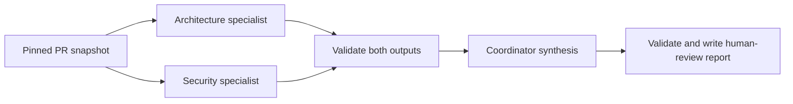

# systems-and-solutions

A professional portfolio of AI-assisted engineering that highlights tools that facilitate architectural decisions,
bounded refactoring, change-risk assessment, and incident learning. The emphasis
is on evidence, explicit boundaries, and human review rather than autonomous
approval.

## Showcase

| Component | Status | Demonstrates |
| --- | --- | --- |
| [Architect agent](.github/agents/architect-agent.agent.md) | Verified across multiple surfaces | Evidence-based change analysis and ADR skill composition |
| [ADR skill](.github/skills/architectural-decision-record/SKILL.md) | Verified across multiple surfaces | On-demand instructions, a reusable template, and proposed decision records |
| [Refactor guard](.github/agents/refactor-guard.agent.md) | Verified across multiple surfaces| Scoped Python modernization, behavioral contracts, and a deterministic change gate |
| [PR impact and security summarizer](docs/examples/pr-impact-walkthrough.md) | Verified end-to-end in GitHub Actions, including advisory review publication | Deterministic risk scoring, cited SDK observations, and opt-in advisory reviews |
| [Incident post-mortem CLI](docs/examples/incident-postmortem-walkthrough.md) | Verified locally in offline and SDK modes | Text/JSONL ingestion, deterministic timelines, cited SDK analysis, and explicit failure handling |
| [Multi-agent PR review team](docs/examples/review-team-walkthrough.md) | Verified locally in replay and live SDK modes; Actions success pending | Parallel isolated specialists, validated handoffs, coordinator synthesis, and human review |

The original five showcase components have been validated in their documented
scenarios.
On 2026-10-15, the PR summarizer's
[successful Actions run](https://github.com/krshearman/systems-and-solutions/actions/runs/38802036685)
completed both analysis and publication, posting an
[advisory COMMENT review on the test PR](https://github.com/krshearman/systems-and-solutions/pull/5#pullrequestreview-5539452380).

The showcase now includes two standalone agents, three SDK review-team role
profiles, and a reusable ADR skill. The review team demonstrates **actual
application-orchestrated multi-agent execution**: two separate specialist
sessions run concurrently, then a third session consumes their validated results.
Transitions between the original architect and refactor-guard agents remain
manual. This is not a claim of native handoffs or identical behavior across
Copilot surfaces.

## Try the architect agent

Open this repository in a supported Copilot surface, such as VS Code or GitHub Copilot Cloud Agent from with the UI, and select `architect-agent`
from its custom-agent picker. For Copilot CLI specifically, start your installed,
authenticated CLI from the repository root:

```sh
copilot
```

Then select the custom agent and submit:

```text
Use the architectural-decision-record skill to assess the decision to keep a
shared architect agent profile across Copilot surfaces, with manual transitions
instead of surface-specific handoffs. Read the repository's engineering
guidelines and surface compatibility guide. Draft a proposed ADR for human
review; distinguish documented platform support from execution verified here.
```

For change analysis, provide the relevant diff or PR context as well. The agent
must request missing evidence instead of claiming to have inspected a diff it
cannot access.

See the [walkthrough and acceptance scenarios](docs/examples/architect-walkthrough.md),
[illustrative ADR](docs/adr/0001-share-architect-profile-across-surfaces.md), and
[surface compatibility guide](docs/copilot-surfaces.md). Installation,
authentication, discovery, and tool availability depend on the surface; no SDK
or CI credentials are needed for these repository-local definitions.

## Try refactor guard

The Python example replaces two deprecated synthetic internal helpers without
changing its incident summary's behavior. Its before/after fixtures, contract
tests, and strict syntax-tree gate make the permitted change concrete.

Run the dependency-free checks from the repository root with Python 3.11 or
later:

```sh
python3 -B -m unittest discover -s tests -v
python3 -B tools/check_refactor_guard.py
```

Follow the [live walkthrough](docs/examples/refactor-guard-walkthrough.md) to
seed the legacy target, select `refactor-guard`, and demonstrate the gate moving
from failure to success. The checked-in workspace starts modernized so normal
checks pass. The [rules](docs/refactor-guard-rules.md) define its write boundary,
behavioral invariants, exclusions, and manual architecture escalation.

The [CI workflow](.github/workflows/ci.yml) runs the deterministic checks on
Python 3.11 and 3.13. It makes no model calls and does not verify live agent
behavior.

## Generate an incident post-mortem

The Python CLI accepts timestamped text or JSON Lines and creates an
evidence-linked executive draft. Unlike the bounded refactor example, it can
process your own logs in its documented formats. It never invents timeline
events: timestamps, source-line IDs, and a file fingerprint come from the input.

Start without model access or dependencies:

```sh
mkdir -p reports
python3 -B -m automation.incident_postmortem \
  --input examples/incident_response/service-incident.txt \
  --format text \
  --output reports/incident-evidence.md \
  --offline
```

For SDK-generated analysis, install the pinned optional dependency and follow
the [incident walkthrough](docs/examples/incident-postmortem-walkthrough.md).
Sending logs requires an explicit model choice and `--allow-model-upload`.
Sanitize and approve data first: there is no automatic redaction.

The SDK receives only parsed evidence in a tool-free, isolated session, not
this repository's agents or personal plugins. Reports separate observations
from unverified hypotheses and proposed actions, remain unapproved, and are
never published automatically. Valid citations do not guarantee factual
accuracy. Outputs are never overwritten, and model failures do not silently
become offline reports.

## Assess PR impact and security

The Python summarizer captures an immutable, bounded textual PR diff, evaluates
it against the engineering guidelines, and explains a locally calculated risk
score. Optional SDK observations cite added lines and guideline sections.
The score is a review-priority heuristic, not a vulnerability probability.

Try the deliberately synthetic snapshot without credentials or a model:

```sh
mkdir -p reports
python3 -B -m automation.pr_review analyze \
  --fixture examples/pr_review/pull_request.json \
  --offline \
  --output reports/pr-review.json
```

This creates `reports/pr-review.md` and a machine-readable JSON bundle. Nothing
is posted. The fixture's PR number, SHAs, source snippets, and dependency are
fictional; it is not a review of an actual pull request.

The [walkthrough](docs/examples/pr-impact-walkthrough.md) covers live PR input,
SDK authentication, the scoring rubric, and the maintainer-triggered
[Actions workflow](.github/workflows/pr-impact.yml). Report-only is the default.
Explicit publication uses a separate job with review-write permission,
revalidates the PR and guidelines, and submits only `COMMENT` reviews.
It never checks out or executes PR code and never approves a merge.

## Run the multi-agent review team

The architecture and security specialists independently receive the same pinned
PR snapshot in separate SDK contexts. The coordinator receives their validated
observations and cited snippets, prioritizes every finding without changing its
severity, and flags potential disagreements for a human to resolve.



Try the complete coordination path with authored synthetic outputs and no
credentials, dependencies, or model calls:

```sh
mkdir -p reports
python3 -B -m automation.review_team \
  --fixture examples/pr_review/pull_request.json \
  --replay examples/review_team/replay.json \
  --output reports/review-team.json
```

Replay is explicitly labeled simulation, not live agent execution. Follow the
[walkthrough](docs/examples/review-team-walkthrough.md) for three real SDK
requests, the trace and handoff contracts, and the separate
[report-only Actions workflow](.github/workflows/pr-review-team.yml).
The application loads the three role-profile bodies explicitly; it does not
rely on native agent discovery. Neither replay nor live mode publishes reviews,
edits code, or replaces human judgment. Separate contexts using the same model
are not independent corroboration.

## Design and boundaries

The [engineering guidelines](docs/engineering-guidelines.md) define this
showcase's constraints. The architect reads evidence and uses the ADR skill to
draft documentation; it does not change application code, accept decisions,
certify compliance, or publish reviews.

Agent instructions are behavioral boundaries, not a security sandbox. Tool
permissions and human review remain necessary. Worked examples are synthetic,
not claims of production use. Architecture/ADR and refactor-guard surface
verification were reported by the maintainer. The tools' local SDK runs use
bundled synthetic evidence, and PR analysis and advisory review publication
have also been verified end-to-end in GitHub Actions. Broader model and
platform compatibility is not claimed. The SDK workflows require explicit
upload approval and configured credentials.
Only the single-agent PR summarizer supports opt-in publication; the review
team is report-only. Successful execution does not establish that every AI
observation is correct.
